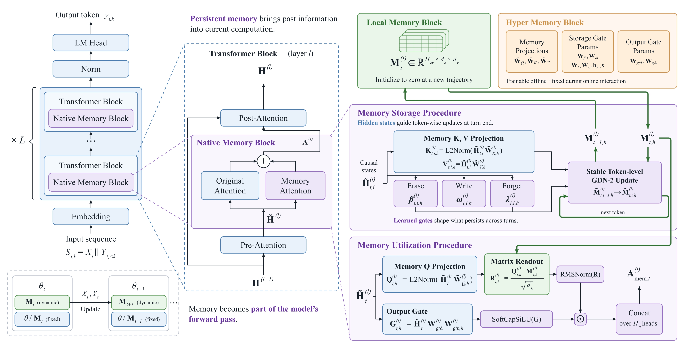
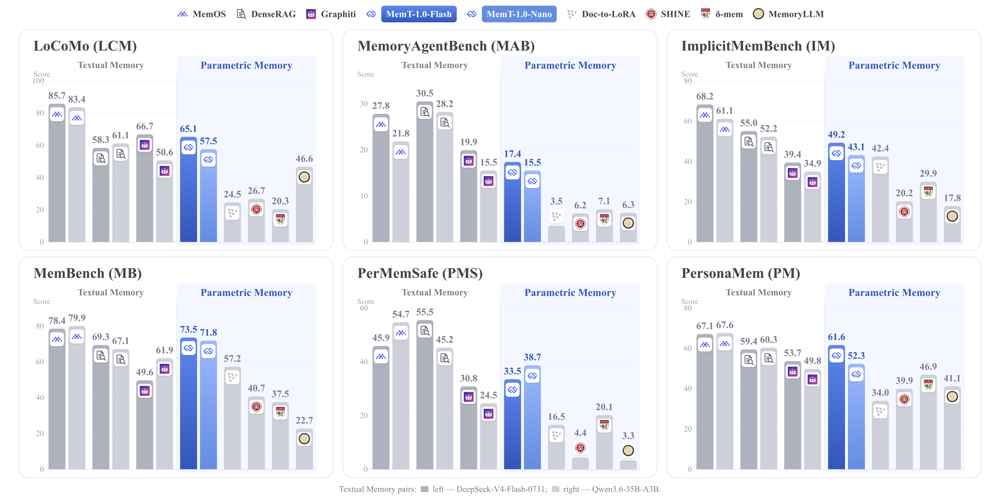
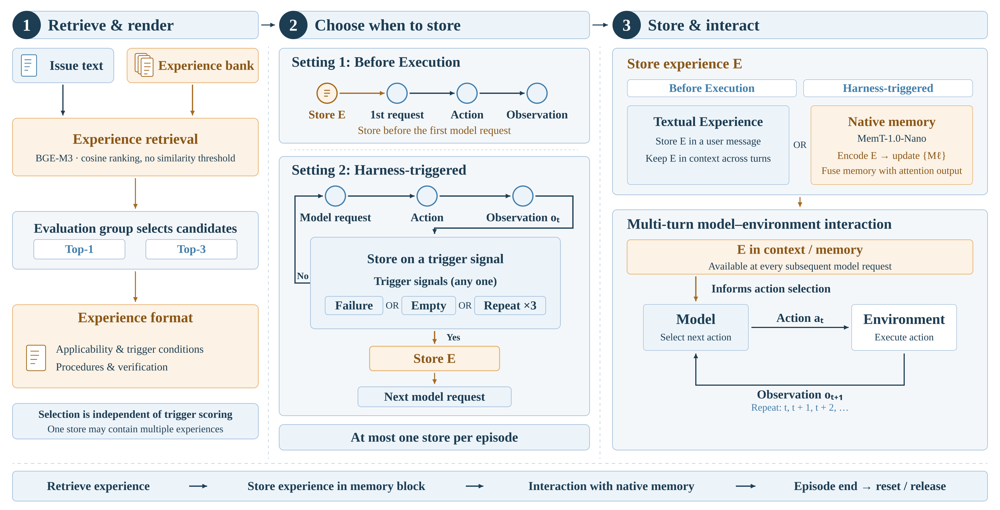

<div align="center">
  <picture>
    <source media="(prefers-color-scheme: dark)" srcset="assets/MemT-1.0.png">
    <source media="(prefers-color-scheme: light)" srcset="assets/MemT-1.0.png">
    
  </picture>

  <p align="center">
    <a href="https://huggingface.co/collections/MemTensor/memt-1"></a>
    <a href="https://arxiv.org/abs/2610.26825">
      
    </a>
  </p>

  <p align="center">
    <a href="README.md">English</a> | <strong>中文</strong>
  </p>
</div>

<a id="overview"></a>
## 💡 概述

**MemT-1.0 是新一代记忆基础模型，能够将持久、动态演化的记忆作为模型计算过程的内在组成部分。**

MemT-1.0 将动态 Local Memory 与可训练的 Hyper Memory 相结合，使模型无需在推理时访问原始上下文，也能保留并利用历史信息。其持久状态的大小保持恒定；当历史长度达到 128K 时，与保存完整上下文的 KV Cache 相比，存储开销可减少约 **66 倍**。

本项目主要包含三项贡献：

- **记忆架构。** 提出 MemT-1.0，以改进记忆的存储与利用方式；同时提出 Mixture-of-Storage （MoS）机制，以扩展记忆容量。
- **训练与评测。** 构建骨干模型准备流程和两阶段训练流程，使用 340 亿 token 的训练数据及专用基础设施，并对记忆能力和通用能力进行评估。
- **扩展性与应用。** 研究记忆能力的扩展规律，并展示原生记忆在经验引导的智能体编程任务中的应用。

### 模型系列

| 模型 | 骨干模型 | 总参数量 | 激活参数量 | 可训练记忆参数量 | 动态记忆状态 |
|---|---|---:|---:|---:|---:|
| [MemT-1.0-Nano](https://huggingface.co/MemTensor/MemT-1.0-Nano) | Qwen3.6-35B-A3B | 36B | 3B | 451M | 10M |
| [MemT-1.0-Flash](https://huggingface.co/MemTensor/MemT-1.0-Flash) | DeepSeek-V4-Flash | 288B | 17B | 3.61B | 336M |

### 架构

**原生记忆模块（Native Memory Block）** 与骨干模型的注意力模块并行运行，包含两个组件：

- **局部记忆模块（Local Memory Block）**：维护一个动态的多通道记忆矩阵，并在连续的交互过程中不断演化。
- **超记忆模块（Hyper Memory Block）**：包含可训练的记忆 Query、Key 和 Value 投影，以及擦除门、写入门、遗忘门和输出门。

在生成过程中，记忆注意力从当前记忆状态中读取信息，对读出结果进行归一化和门控处理，再将其加到骨干模型的注意力输出上。在每轮交互或每个片段结束时，Stable GDN-2 执行 token 级别的记忆更新，从而生成供后续步骤使用的新记忆状态。



### 评测结果

在 11 个记忆基准上，MemT-1.0-Flash 和 MemT-1.0-Nano 在**已评测的参数化记忆方法**中分别排名第一和第二。总体而言，表现较强的文本记忆系统仍然领先，尤其是在需要从长历史中检索细粒度证据的任务上。



### 经验引导的智能体编程

MemT-1.0 提出了一种智能体框架，用于在长程编程任务中复用程序性经验。检索到的经验被存入原生记忆，并在执行过程中通过记忆注意力访问，无需将经验文本加入任务上下文，即可提升任务表现。



<a id="quick-start"></a>
## 🚀 快速开始

以下示例通过 SGLang 部署 MemT-1.0-Nano，并使用 `memt_sglang` Python 客户端进行带原生记忆的对话。部署细节和 MemT-1.0-Flash 配置见[中文推理指南](inference/README_zh.md)或[英文推理指南](inference/README.md)。

### 安装

在配有 NVIDIA CUDA 的 Linux 服务器上，使用 Python 3.11 或更高版本，从仓库的 `inference` 目录安装：

```bash
cd inference
uv pip install '.[server]'
```

如果 Python 客户端运行在独立环境中，请在该环境中从同一目录安装客户端可选依赖：

```bash
uv pip install '.[client]'
```

### 启动服务

使用完整的本地 MemT-1.0-Nano checkpoint，包含匹配的 BF16 权重、配置和 tokenizer 文件：

```bash
sh start_memt_nano.sh /models/MemT-1.0-Nano
```

该示例使用两张 GPU，服务地址为 `http://127.0.0.1:30000`，记忆快照保存在服务端的 `./memt-state`。保持服务运行，并在另一个终端中执行下面的 Python 示例。部署 Flash 时，使用 [start_memt_flash.sh](inference/start_memt_flash.sh) 和[推理指南](inference/README_zh.md#python-客户端)中的 Flash 客户端配置。

### 连接客户端

使用与服务端 checkpoint 匹配的本地 tokenizer 文件。客户端加载 tokenizer；模型推理在 SGLang 服务端执行。

```python
import os
from transformers import AutoTokenizer
from memt_sglang.client import MemTSession, NativeClient, load_chat_format

model_path = "/models/MemT-1.0-Nano"
tokenizer = AutoTokenizer.from_pretrained(
    model_path,
    local_files_only=True,
    trust_remote_code=False,
)
# chat_format 负责输入模板和编码；parser 负责解析 Thinking 和工具调用。
chat_format, parser = load_chat_format(
    model_path,
    tokenizer=tokenizer,
    chat_template_kwargs={"enable_thinking": False},
)
client = NativeClient(
    "http://127.0.0.1:30000",
    api_key=os.environ.get("MEMT_API_KEY"),
)
```

### 体验带记忆的对话

记忆读取默认开启，已提交的记忆会自动用于回答。设置 `enable_memory=True`，在当前回答完成后，将尚未保存的历史及当前逻辑轮写入潜在局部记忆，并清除这些轮次的推理明文上下文；首轮即可使用。工具链在最终回答完成后保存；截断回答保留供后续提交或保存。`chat()` 默认返回回答文本；传入 `return_dict=True` 可获得结构化结果。下面的输出仅作示意。

```python
session = MemTSession(client, chat_format, parser)

answer = session.chat(
    "I have a three-month-old kitten named memmy who loves eating "
    "small shrimp and is excellent at remembering things."
)
print(answer)
# Memmy is three months old, loves small shrimp, and has an excellent memory.

# 回答后，将介绍小猫和当前游戏两轮问答保存到潜在局部记忆，并清除其推理明文上下文。
answer = session.chat(
    "What is a simple game I can play with my kitten?",
    enable_memory=True,
)
print(answer)
# Try gently moving a wand toy for your kitten to chase.

# 使用潜在局部记忆中保存的小猫信息回答。
answer = session.chat(
    "What are my kitten's name, age, favorite food, and special trait?",
    enable_memory=True,
)
print(answer)
# Based on the information you provided earlier:
#
# *   **Name:** Memmy
# *   **Age:** Three months old
# *   **Favorite Food:** Small shrimp
# *   **Special Trait:** An excellent memory
```

### 保存与恢复

`save_state(path)` 会先提交剩余问答，再保存快照。返回的 `path` 标识服务端快照目录中的文件；恢复会话时将其传给 `state`。

```python
# 保存局部记忆，包括所有尚未保存的对话轮次。
snapshot = session.save_state("memmy_memory.safetensors")
session.close()

# 恢复记忆，不恢复此前的对话记录。
with MemTSession(client, chat_format, parser, state=snapshot["path"]) as restored:
    print(len(restored.messages))
    # 0

    answer = restored.chat("How old is my kitten?")
    print(answer)
    # Your kitten is **3 months old**.
```

### 标准对话

新建独立会话，不加载快照，并关闭记忆读取。使用 `enable_memory=False` 保持自动历史写入关闭；此前轮次仍保留在对话记录中。

```python
with MemTSession(client, chat_format, parser) as chat:
    chat.set_memory_read(False)
    answer = chat.chat(
        "Type 'I love MemT' exactly.",
        enable_memory=False,
    )
    print(answer)
    # I love MemT
```

<a id="citation"></a>
## 📝 引用

如需引用 MemT-1.0 技术报告，请使用以下 BibTeX：

```bibtex
@misc{memtensor2026memt1,
  title         = {MemT-1.0: Towards Memory-Native Evolution},
  author        = {{MemTensor Team}},
  year          = {2026},
  eprint        = {2610.26825},
  archivePrefix = {arXiv},
  primaryClass  = {cs.CL},
  url           = {https://arxiv.org/abs/2610.26825}
}
```

## ⚖️ 许可证

本文档所涉及的论文与仓库软件采用不同的许可证：

- **论文：** 技术报告及原始论文材料采用 [知识共享署名—非商业性使用—相同方式共享 4.0 国际许可协议（CC BY-NC-SA 4.0）](LICENSE-PAPER)。
- **仓库软件：** 本仓库中的原创源代码（包括 SGLang 集成）采用 [PolyForm 非商业许可证 1.0.0](LICENSE)。

随包提供的第三方组件保留各自的许可证。SGLang 集成包含采用 MIT 许可证的 flash-linear-attention 代码，详见[组件许可证表](inference/README_zh.md#许可证)。

根据 PolyForm 非商业许可证，禁止将本仓库软件用于商业用途。如需商业授权，请联系作者。

除非另有明确说明，上述许可证不涵盖模型权重、数据集、基准测试资源、商标及第三方材料。相关材料的适用条款将在对应版本发布时另行说明。

## 📬 联系方式

学术交流与研究联系： [lizy@memtensor.cn](mailto:lizy@memtensor.cn)。
